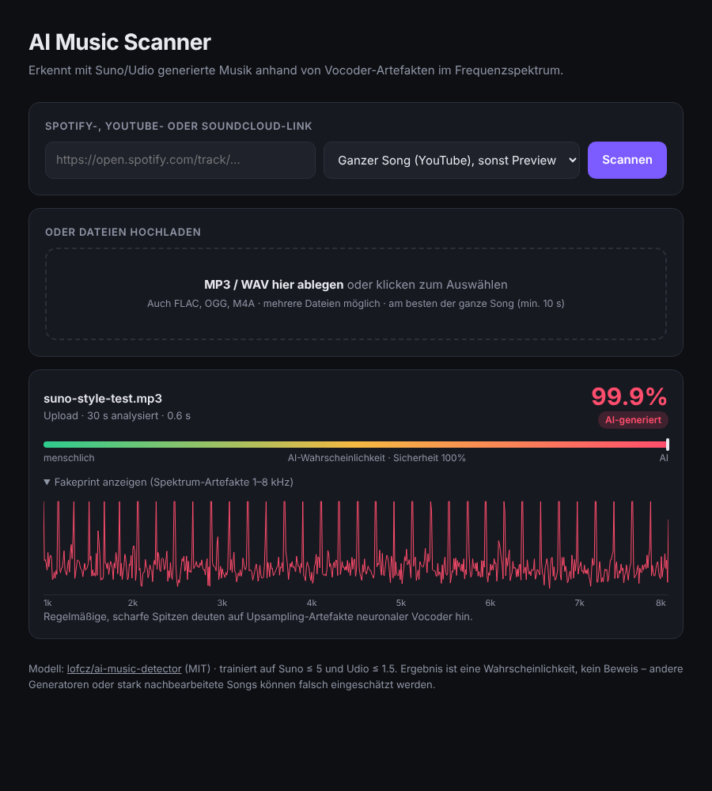

# AI Music Scanner

Web-App, die prüft, ob ein Song mit KI (Suno ≤ 5, Udio ≤ 1.5) generiert wurde.
Rein kommen **Spotify-Links** (oder YouTube/SoundCloud-Links) oder hochgeladene **MP3/WAV-Dateien** (auch FLAC, OGG, M4A).



## Starten

Voraussetzung: Python 3.10+ und `ffmpeg`.

```bash
python -m venv .venv
source .venv/bin/activate
pip install -r requirements.txt
uvicorn app.main:app --port 8000
```

Dann http://localhost:8000 öffnen.

Oder mit Docker:

```bash
docker build -t ai-scanner . && docker run -p 8000:8000 ai-scanner
```

## Wie es funktioniert

Der Detektor nutzt das Modell aus [lofcz/ai-music-detector](https://github.com/lofcz/ai-music-detector)
([Hugging Face](https://huggingface.co/lofcz/ai-music-detector), MIT, Paper: *A Fourier Explanation of AI-Music
Artifacts*, ISMIR 2025). Neuronale Vocoder/Decoder hinterlassen durch Upsampling (transponierte Faltungen)
regelmäßige Spitzen im Spektrum zwischen 1 und 8 kHz. Das Modell berechnet aus dem gemittelten Spektrum einen
„Fakeprint“ und klassifiziert ihn.

`app/detector.py` ist ein torch-freier Port des originalen `inference.py` (numpy + onnxruntime):
Resampling auf 16 kHz (identisch zu torchaudios `sinc_interp_hann`), STFT n_fft=8192, 1–8 kHz,
untere Hüllkurve, Normalisierung → `models/ai_music_detector.onnx` → Wahrscheinlichkeit (Schwelle 0,5).

### Spotify-Links

Spotify liefert kein volles Audio aus. Bei einem Track-Link macht die App deshalb:

1. Titel/Künstler von Spotify lesen (öffentliche Embed-Seite; optional über die Web-API, wenn
   `SPOTIFY_CLIENT_ID`/`SPOTIFY_CLIENT_SECRET` gesetzt sind),
2. den Song per `yt-dlp` auf YouTube suchen (Länge muss auf ±30 s passen) und den ganzen Track analysieren,
3. wenn das nicht klappt: die 30-s-Preview von Spotify nehmen.

Die UI zeigt an, welche Quelle analysiert wurde. Prüf, ob der YouTube-Treffer wirklich der richtige Song ist.
Eine 30-s-Preview ist weniger zuverlässig als der ganze Song.

## Grenzen

- Trainiert nur auf Suno/Udio. Andere Generatoren oder stark nachbearbeitete/neu kodierte Songs können falsch
  eingeschätzt werden.
- Das Ergebnis ist eine Wahrscheinlichkeit, kein Beweis.
- Pro Song werden max. 300 s analysiert (wie im Original).

## Tests

```bash
pip install pytest
python -m pytest
```
